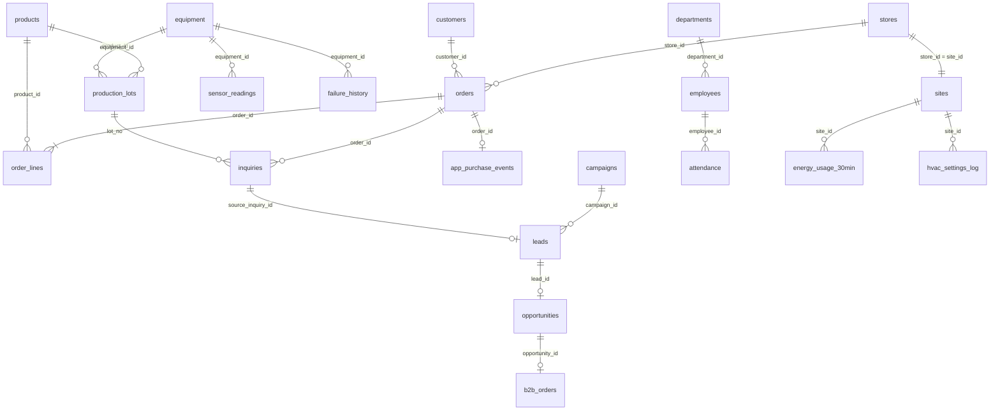

# Zenn × Microsoft Fabric 記事投稿コンテスト向け ダミーデータ（サンプル）

> **ステータス：案（ドラフト）** — データの種類・ボリューム・配布方法・ライセンスは、主催者（Zenn／クラスメソッド、日本マイクロソフト）で調整中です。

架空のコーヒー会社 **「コントソ珈琲株式会社（Contoso Coffee）」** の業務データです。
打ち合わせで挙がった **構造化データ 5 種 ＋ 非構造・半構造データ 3 種** を、すべて同じ 1 つの会社のデータとして作っています。
そのため、店舗 ID・商品 ID・顧客 ID・従業員 ID・注文番号・ロット番号などで **データ同士をつなげて分析** できます。

- 2〜3 年分の日次〜1 分単位のデータで、季節・曜日・天気の影響、トラブル、施策の効果などの「出来事」が含まれています。
- 売上・配送・電力などは、**各地の実際の天気（気象庁の観測値）に連動** させています。気象庁のデータと結合すると関係が見えます。
- 実データらしさのため、欠損・重複・表記ゆれ・入力ミス・書式の違いを意図的に含めています。
- すべて架空のデータです。個人情報は含みません。

## データセット一覧

| # | フォルダ | 種類 | 中身 | 期間 | 規模 | 形式 |
|---|---|---|---|---|---|---|
| 1 | [`01_retail_ec`](data/01_retail_ec/README.md) | 小売・EC | 受注明細／商品／顧客／店舗（＋受注ヘッダ、価格履歴、販促、定期便、休業記録） | 2024-01〜2026-10（34 か月） | 受注 49 万件・明細 79 万行・会員 3.2 万人・店舗 16 | CSV |
| 2 | [`02_manufacturing_iot`](data/02_manufacturing_iot/README.md) | 製造・IoT | 設備のセンサー値（1 分ごと）／故障の履歴／設備（＋製造ロット） | センサー 2026-05〜10（6 か月）、履歴 2025-01〜 | センサー 212 万行・設備 8 台・ロット 1.3 万 | CSV |
| 3 | [`03_sales_marketing`](data/03_sales_marketing/README.md) | 営業・マーケティング | キャンペーン／広告費／リード／商談／受注（＋商談ステージ履歴） | 2024-11〜2026-10（24 か月） | リード 1.05 万・商談 1,572・受注 441 | CSV |
| 4 | [`04_hr_attendance`](data/04_hr_attendance/README.md) | 人事・勤怠 | 従業員／勤怠／残業（申請）／研修の受講／退職者（＋部署） | 2024-11〜2026-10（24 か月） | 従業員 628 人・勤怠 19.5 万行・退職 201 人 | CSV |
| 5 | [`05_facility_energy`](data/05_facility_energy/README.md) | 施設・エネルギー | 拠点／電力・ガスの使用量（30 分ごと）／空調の設定 | 2024-11〜2026-10（24 か月） | 22 拠点・73 万行・空調ログ 3 万件 | CSV |
| 6 | [`06_customer_support`](data/06_customer_support/README.md) | 非構造（テキスト） | 問い合わせ本文／受付日時／チャネル／関連する商品／対応状況 | 2024-01〜2026-10 | 9,378 件 | CSV ＋ JSON Lines |
| 7 | [`07_excel_reports`](data/07_excel_reports/README.md) | 非構造（Excel 帳票） | 店舗ごとに書式が違う日報・発注書／表記ゆれ／結合セル | 日報 2026-10、発注書 2026-09〜10 | 8 店舗・251 ファイル（＋品目マスタ） | xlsx（1 店舗のみ Shift_JIS の CSV） |
| 8 | [`08_app_logs`](data/08_app_logs/README.md) | 半構造（JSON） | 日時／ユーザー ID（匿名）／画面／操作の種類／端末 | 2026-09〜10（2 か月） | 13.4 万イベント（61 ファイル） | JSON Lines |
| - | [`00_common`](data/00_common/README.md) | 共通 | カレンダー（祝日・会計年度） | 2024-01〜2026-12 | 1,096 日 | CSV |

全ファイルの行数・サイズは [`data/MANIFEST.csv`](data/MANIFEST.csv)、全テーブル・全列の定義は [`docs/data_dictionary.md`](docs/data_dictionary.md) にあります。

## 会社の設定

| 項目 | 内容 |
|---|---|
| 会社 | コントソ珈琲株式会社（架空）。コーヒー豆の焙煎・販売。本社は東京・渋谷 |
| 直営店 | 16 店舗（札幌〜那覇）。コーヒー豆・焼き菓子・ギフトの専門店で、ドリンクのテイクアウトと小さな客席を併設。2025 年に金沢・那覇が開店、心斎橋が閉店 |
| オンライン | オンラインストア（Web・公式アプリ）と、2024-06 に始めた定期便 |
| 法人事業 | オフィスコーヒーサービスと業務用豆の卸。東京本社・大阪・名古屋・福岡の営業拠点 |
| 工場・物流 | 埼玉県熊谷市の自社工場（焙煎機 2 台・グラインダー・包装機 2 台・オーブン・コンプレッサー・チラー）、千葉の物流センター |
| 出来事の例 | 2025-04 の価格改定（コーヒー豆の国際価格の高騰）、新商品の発売、店舗の改装・開閉店、大雨での臨時休業、設備の故障、アプリの不具合 など |

## データのつながり



- 店舗の `store_id`（S01〜S16）は、05 の拠点 `site_id` と同じ値です。
- 従業員 ID は、故障対応の担当者（02）、商談・リードの担当者（03）、問い合わせの担当者（06）にも使われています。
- 問い合わせ本文や Excel 帳票の中には、注文番号・ロット番号・店舗名・商品名が **自由記述（表記ゆれあり）** で登場します。

## 共通の仕様

| 項目 | 仕様 |
|---|---|
| 文字コード・改行 | UTF-8（BOM なし）、LF。※07 の那覇店の CSV だけは Shift_JIS（帳票の課題として意図的） |
| 日時 | 日本時間（JST）。CSV はタイムゾーン表記なしの `YYYY-MM-DD HH:MM:SS`。08 のアプリログは ISO 8601（+09:00） |
| 金額 | 円。税抜・税込は列名で区別（例：`subtotal_excl_tax`、`total_incl_tax`） |
| 列名 | 英語のスネークケース（Fabric のテーブル、SQL、GraphQL で扱いやすいように）。日本語の説明はデータ辞書に記載 |
| 主キー | ほぼすべてのテーブルに主キー列を用意（API for GraphQL で公開するテーブル・ビューには主キーが必要なため） |
| ファイルの分割 | 大きいテーブルは年・月ごとに分割し、テーブルごとのフォルダ（例：`orders/`）に入れています。レイクハウスの「テーブルに読み込む」でフォルダごと 1 テーブルにできます |

## 気象データ・家計調査と組み合わせる

- 店舗・拠点には最寄りの **気象庁の観測所**（地点名・府県番号 `prec_no`・地点番号 `block_no`）を付けています。
- 来店客数、アイスとホットの比率、配送遅延、電力使用量、工場の設備の負荷は、その地点の **実際の気象（日最高・最低気温、降水量など）** に連動させています。気象庁の「過去の気象データ・ダウンロード」で取得したデータと結合すると関係が見えます。
- 店舗の所在地（都道府県・市区町村）、会員の居住都道府県、商品カテゴリ（コーヒー豆・菓子など）があるので、総務省統計局の **家計調査**（都道府県庁所在市別の品目別支出）との比較もできます。

## Fabric での使い方

- 取り込み手順（試用版）：[`docs/fabric_quickstart.md`](docs/fabric_quickstart.md)
- お題・分析アイデアの例：[`docs/analysis_ideas.md`](docs/analysis_ideas.md)

試用版の容量では、Copilot、データ エージェント、AI 関数などの AI 機能は使えません。非構造データは、ノートブックでの取り込み・加工（テキスト集計・形態素解析など）を基本とし、AI での分析は参加者自身の Azure OpenAI（Microsoft Foundry）と組み合わせる任意の発展としています。

## フォルダ構成

配布用の ZIP は 2 種類あります。

| ZIP | 中身 | 用途 |
|---|---|---|
| `*_participants.zip` | `README.md`、`data/`、`docs/`、`tools/replay_sensor_to_eventstream.py` | コンテスト参加者への配布用（答えを含まない） |
| `*_full.zip` | このリポジトリ一式（`_organizer_only/`、`generator/` を含む） | 主催者・レビュー用 |

```
.
├─ README.md                 … このファイル
├─ data/                     … データ本体（参加者に配布する ZIP の中身）
│   ├─ MANIFEST.csv          … 全ファイルの行数・サイズ
│   ├─ 00_common/ … 08_app_logs/   … 各データセット（それぞれ README.md つき）
├─ docs/
│   ├─ data_dictionary.md    … 全テーブル・全列の定義（自動生成）
│   ├─ fabric_quickstart.md  … Fabric（試用版）での取り込み手順
│   ├─ analysis_ideas.md     … お題・分析アイデアの例
│   └─ validation_report.md  … 整合性チェックの結果（自動生成）
├─ _organizer_only/          … 主催者向け（仕込んだ出来事の一覧・帳票の正解データ）。参加者には配布しない
├─ generator/                … 再生成用の Python コード（気象庁データのキャッシュを含む）
└─ tools/                    … 検証・ドキュメント生成・ZIP 作成・センサー値のストリーミング再生
```

## 再生成

乱数のシードを固定しているので、同じコマンドで同じデータができます（所要時間は約 10 分、Python 3.11 以降）。

```bash
cd generator
pip install -r requirements.txt
python generate.py --out ../data --organizer-out ../_organizer_only/expected_outputs
cd ..
python tools/build_docs.py     # データ辞書と各フォルダの README を更新
python tools/validate.py       # 主キー・外部キー・金額の整合性をチェック
```

期間や規模、会社の設定は `generator/contoso_data/config.py` と各モジュールで変更できます。

## 注意事項

- **すべて架空のデータです。** 会社・店舗・人物・取引先・メーカー・競合の名前は実在のものとは関係ありません（Contoso、Fabrikam、Northwind、Tailspin、Woodgrove、Litware は Microsoft のサンプルで使われる架空の名前です）。
- 個人情報は含みません。従業員の氏名はランダムな組み合わせです。顧客は ID・性別・生まれ年・都道府県のみで、氏名・住所・連絡先はありません。
- 天気の影響は、気象庁「過去の気象データ」の観測値をもとに付けています。`generator/reference/jma_daily_weather.csv` は「気象庁ホームページ（https://www.data.jma.go.jp/stats/etrn/index.php）の過去の気象データを加工して作成」したものです。
- ライセンス・利用条件は主催者と調整中です（案：データは CC BY 4.0、コードは MIT）。
